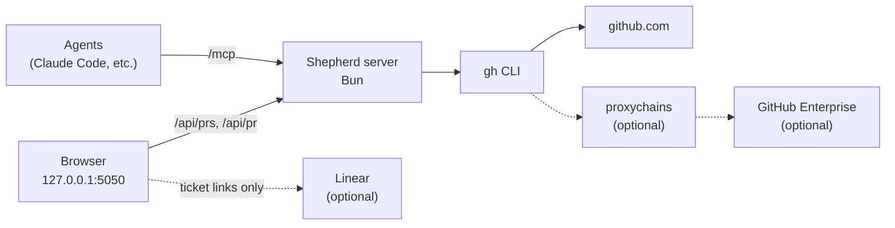

# Shepherd

**A live dashboard of your team's open pull requests, and an MCP server your agents can ask about them.**

[Quick start](#quick-start) · [Requirements](#requirements) · [Configuration](#configuration) · [Documentation](#documentation) · [Troubleshooting](#troubleshooting) · [Contributing](CONTRIBUTING.md)

Shepherd tracks your team's open pull requests across one or more GitHub hosts (github.com and any GitHub Enterprise Server) in one table. It answers the questions a lead asks several times a day:

- **What is waiting on me?** PRs that request your review or your review team's, PRs where someone else had the last word (unless you already approved), and your own PRs with requested changes, marked in orange.
- **What is ready to go out?** Approved work with no conflicts or failed checks sits at the top with a green border. Approved work that is blocked follows with a dark cyan border. Approvers and change requests are named.
- **What has the AI reviewer flagged that nobody has resolved?** The count of unresolved threads opened by your code-review bot, split into "fix" and "minor", with links to each finding.
- **Who do I ping, and is it my turn?** Everyone who has commented, reviewed or committed, most recently active first, plus who acted last. When someone else had the last word on a PR you're part of and you haven't already approved it, it's marked as your turn.
- **How does this work fit together?** Stacked PRs share one row, and each row links its Linear tickets and related PRs.

Rows refresh on their own, one at a time, and update in place. The same data is available to agents over [MCP](docs/mcp.md).

## How it fits together



Solid lines are required. Dashed lines switch on when you configure them. Shepherd runs `gh api graphql` for every call, so `gh` owns authentication and Shepherd never sees a token. Linear is only linked to; Shepherd does not call its API.

## Requirements

| Component | Required? | What it gives you | Check |
| --- | --- | --- | --- |
| [Bun](https://bun.sh) 1.1+ | **Required** | Runs the server and bundles the page | `bun --version` |
| [GitHub CLI](https://cli.github.com) signed in to each host you track | **Required** | All GitHub data | `gh auth status --hostname github.com` |
| Read access to the tracked repos | **Required** | PRs you cannot read are left out | |
| `proxychains4` | Optional | Reaching a GitHub Enterprise Server that is only reachable through a SOCKS proxy | `proxychains4 --help` |
| A Linear workspace | Optional | Ticket links on each row | |
| [herdr](https://herdr.dev) | Optional | A chip on each row for the terminal panes working on that PR | |

If one host is unreachable, the dashboard still shows the other hosts' PRs and keeps the last known data for the unreachable one.

## Quick start

### 1. Check GitHub access

```sh
gh auth status --hostname github.com
```

It prints `Logged in to github.com account <you>`. If not, run `gh auth login`. For a GitHub Enterprise host, see [GitHub Enterprise and proxies](docs/github-enterprise.md).

### 2. Install and configure

```sh
git clone git@github.com:Automattic/shepherd.git
cd shepherd
bun install
cp config.example.json config.json
```

Open `config.json`. List your team under `team` (with each person's login per host), set `me` to your own `id`, and list the repos to watch under `repos`. `config.json` is gitignored. See [Configuration](#configuration).

### 3. Start it

```sh
bun run start
```

The server prints:

```text
Shepherd dashboard: http://127.0.0.1:5050
MCP endpoint:       http://127.0.0.1:5050/mcp
```

Open <http://127.0.0.1:5050>. The rows appear within a second or two. Their details fill in over the next several seconds while the cache is empty, and come back faster after that.

If the config has a problem, the server stops before listening and lists what to fix.

### 4. Check the connection

```sh
curl -s 'http://127.0.0.1:5050/api/prs?reviewers=<your-id>' | jq '{count: (.prs | length), errors}'
```

`errors` should be `{}`. If it names a host, see [Troubleshooting](#troubleshooting).

### 5. Connect your agents (optional)

```sh
claude mcp add --transport http --scope user shepherd http://127.0.0.1:5050/mcp
claude mcp list
```

`claude mcp list` shows `shepherd` as connected while the server is running. The tools are `review_queue`, `list_prs`, `merged_prs`, `get_pr` and `team`; see [MCP server for agents](docs/mcp.md) for what each returns and how to register with a token.

## Configuration

`config.json` is local and gitignored; `config.example.json` is the template. The keys you need to start:

| Key | Purpose |
| --- | --- |
| `me` | The `id` of the team member the dashboard treats as "you". |
| `team[]` | `id`, `name`, `short` (the label on screen), and `logins`: one login per host key. |
| `hosts.<key>` | Each GitHub host: `hostname`, `label`, and `bot` (the AI-review bot's login, or `null`). |
| `repos[]` | `host` (a key from `hosts`), `owner`, `name`, and `short` (the label on screen). |
| `linear` | Optional. Your Linear workspace and team keys, for ticket links. |

The server binds to `127.0.0.1` only. On a shared machine, set `SHEPHERD_TOKEN` to lock `/mcp` and `/api/*`; see [Token](docs/configuration.md#token-optional).

Every key, with defaults, is in [Configuration](docs/configuration.md).

## Documentation

**Using Shepherd**

- [Using the dashboard](docs/dashboard.md): columns, sort order, what "waiting on" means, base age, Shipped, stacks and controls
- [MCP server for agents](docs/mcp.md): tools, arguments, example prompts and token setup
- [herdr terminal panes](docs/herdr.md): linking terminal panes to the PRs they work on
- [How refreshing works](docs/refreshing.md): reload order, rate-limit floors, and how merged or closed PRs leave the list

**Reference**

- [Configuration](docs/configuration.md): every `config.json` key, the token and AI-review bots
- [Review teams](docs/review-teams.md): count a GitHub team review request as waiting on each member
- [GitHub Enterprise and proxies](docs/github-enterprise.md)

**Working on Shepherd**

- [Contributing](CONTRIBUTING.md): checks and code layout

## Troubleshooting

| Symptom | Cause and fix |
| --- | --- |
| `No config found at …/config.json` on start | Run `cp config.example.json config.json` and fill it in. |
| `config.json has problems:` on start | Fix each listed item. A team member with old `ghe`/`github` fields needs them moved into `logins`. |
| Red banner: **\<host\> could not be reached** | `gh` is not signed in to that host, or its proxy is down. Run the `gh auth status` check for that host. |
| Red banner: **Dashboard server could not be reached** | The server stopped. Start it again with `bun run start`. |
| A row shows a red triangle instead of the refresh icon | That row's last reload failed; hover it to read why. The row keeps its last data and tries again on the next tick. |
| "Waiting on you" differs from GitHub's review count | Shepherd counts direct review requests, PRs where it's your turn, and your PRs with requested changes. Requests to a team count only when the team is in the host's `reviewTeams`; other teams show as grey chips. See [What "waiting on" means](docs/dashboard.md#what-waiting-on-means). |
| A PR you expect is missing | Check the filters, then **Drafts** and **Dormant 60d+**. Only PRs by people in `team`, PRs that request a review from someone whose bell is on, and PRs that request one of the `reviewTeams`, are tracked. |
| A teammate's avatar shows initials | They have no `github` login in `logins`; avatars come from github.com. |
| A bot appears in Participants | Add its login to `ignoreParticipants` and restart. |
| The rate badge in the header turns red | Fewer than 500 github.com points are left this hour. Refreshing slows down by itself and recovers at the reset time shown when you hover the badge. See [How refreshing works](docs/refreshing.md). |
| `claude mcp list` shows shepherd as failed | The server is not running, or it runs on another port, or it has a token and the registration has no `Authorization` header. Start it and check the URL and header you registered. |
| `EADDRINUSE` on start | Something else uses the port. Stop it, or start with `PORT=5051 bun run start`. |

## Development

```sh
bun run dev         # restarts the server when a file changes
bun run check       # typecheck, plus a bundle of the browser client
bun test            # unit tests (src/*.test.ts)
```

See [Contributing](CONTRIBUTING.md) for the code layout.

## License

[MIT](LICENSE).
