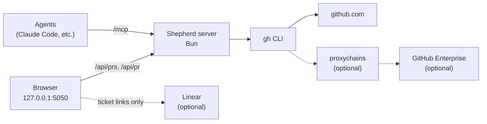

# Shepherd

**A live dashboard of your team's open pull requests, and an MCP server your agents can ask about them.**

[Quick start](#quick-start) · [Requirements](#requirements) · [Using the dashboard](#using-the-dashboard) · [MCP server](#mcp-server-for-agents) · [Configuration](#configuration) · [How refreshing works](#how-refreshing-works) · [Troubleshooting](#troubleshooting) · [Development](#development)

Shepherd tracks your team's open pull requests across one or more GitHub hosts (github.com and any GitHub Enterprise Server) in one table. It answers the questions a lead asks several times a day:

- **What is waiting on me?** PRs that request your review, PRs where someone else had the last word, and your own PRs with requested changes, marked in orange.
- **What is ready to go out?** Approved work with no conflicts or failed checks sits at the top with a green border. Approved work that is blocked follows with a dark cyan border. Approvers and change requests are named.
- **What has the AI reviewer flagged that nobody has resolved?** The count of unresolved threads opened by your code-review bot, split into "fix" and "minor", with links to each finding.
- **Who do I ping, and is it my turn?** Everyone who has commented, reviewed or committed, most recently active first, plus who acted last. When someone else had the last word on a PR you're part of, it's marked as your turn.
- **How does this work fit together?** Stacked PRs share one row, and each row links its Linear tickets and related PRs.

Rows refresh on their own, one at a time, and update in place. The same data is available to agents over MCP.

## How it fits together



Solid lines are required. Dashed lines switch on when you configure them. Shepherd runs `gh api graphql` for every call, so `gh` owns authentication and Shepherd never sees a token. Linear is only linked to; Shepherd does not call its API.

## Requirements

| Component | Required? | What it gives you | Check |
| --- | --- | --- | --- |
| [Bun](https://bun.sh) 1.1+ | **Required** | Runs the server and bundles the page | `bun --version` |
| [GitHub CLI](https://cli.github.com) signed in to each host you track | **Required** | All GitHub data | `gh auth status --hostname github.com` |
| Read access to the tracked repos | **Required** | PRs you cannot read are left out | |
| `proxychains4` | Optional | Reaching a GitHub Enterprise Server that is only reachable through a SOCKS proxy | `proxychains4 --help` |
| A Linear workspace | Optional | Ticket links on each row | |

If one host is unreachable, the dashboard still shows the other hosts' PRs and keeps the last known data for the unreachable one.

## Quick start

### 1. Check GitHub access

```sh
gh auth status --hostname github.com
```

It prints `Logged in to github.com account <you>`. If not, run `gh auth login`. For a GitHub Enterprise host, see [GitHub Enterprise and proxies](#github-enterprise-and-proxies).

### 2. Install and configure

```sh
git clone git@github.com:borkweb/shepherd.git
cd shepherd
bun install
cp config.example.json config.json
```

Open `config.json`. List your team under `team` (with each person's login per host), set `me` to your own `id`, and list the repos to watch under `repos`. `config.json` is gitignored. Every key is described in [Configuration](#configuration).

### 3. Start it

```sh
bun run start
```

The server prints:

```text
Shepherd dashboard: http://127.0.0.1:5050
MCP endpoint:       http://127.0.0.1:5050/mcp
```

Open <http://127.0.0.1:5050>. The rows appear within a second or two. Their details fill in over the next several seconds while the cache is empty, and come back faster after that.

If the config has a problem, the server stops before listening and lists what to fix.

### 4. Check the connection

```sh
curl -s 'http://127.0.0.1:5050/api/prs?reviewers=<your-id>' | jq '{count: (.prs | length), errors}'
```

`errors` should be `{}`. If it names a host, see [Troubleshooting](#troubleshooting).

### 5. Connect your agents (optional)

```sh
claude mcp add --transport http --scope user shepherd http://127.0.0.1:5050/mcp
claude mcp list
```

`claude mcp list` shows `shepherd` as connected while the server is running. See [MCP server for agents](#mcp-server-for-agents).

## Using the dashboard

### The table

| Column | What it shows |
| --- | --- |
| **Pull request** | State icon, title and number, repo, author, Linear tickets, and related PRs. A stacked PR sits under its parent in smaller, inset text. |
| **Waiting on** | Reviewers asked directly, plus an orange **You** pill whenever the PR is waiting on you for any reason (hover it for why). A red **Author** pill means changes were requested and the author hasn't pushed since. Teammates whose bell is on get an orange ring. Team requests (for example from CODEOWNERS) are grey chips. |
| **Approvals** | Who approved (green check) and who asked for changes (red cross), with names. |
| **AI review** | Unresolved review threads opened by the host's AI-review `bot`. **fix** means severity medium or higher and not a nit; **minor** covers everything else. Click the count to list every finding with its file and a link. Shows "n/a" on hosts with no bot. The column name comes from `aiReviewLabel`. |
| **Participants** | Everyone who commented, reviewed or committed, except the author and bots, most recently active first. Hover an avatar to see when that person was last active. Below them, a small line shows who acted last (author included) and how: comment, review or push. It turns orange as **your turn** when someone else had the last word on a PR you wrote or took part in. |
| **Status** | Draft, checks, merge conflicts, a thumbs-up when the review decision is approved, and lines added and removed. |
| **Updated** | When the PR last changed. Hover the row for a refresh button that reloads just that row. |

### Order and approved work

Rows are sorted in four bands:

1. **Ready to ship** (green border): approved, with no merge conflicts and no failed checks. Pending checks don't block.
2. **Approved but blocked** (dark cyan border): approved, but a PR has merge conflicts or failed checks.
3. **Waiting on you** (orange left bar).
4. Everything else, most recently updated first.

### What "waiting on" means

A PR is waiting on someone when any of these is true:

- **Requested:** GitHub lists them as a pending reviewer, asked directly rather than through a team. Submitting any review clears it; the author can re-request it.
- **Their turn:** someone else commented, reviewed or pushed most recently on a PR they wrote or took part in.
- **Author:** they wrote it, someone requested changes, and nothing has been pushed since.

The **Waiting on you** tile, the orange left bar, the sort order and each person's hourglass all use this definition, as does the `review_queue` MCP tool. The rules live in `src/waiting.ts`.

A PR counts as approved when GitHub's review decision is approved, or when at least one person approved and nobody requested changes. A stack counts as approved only when every open PR in it is approved, and it is green only when none of them has conflicts or failed checks. A partly approved stack stays in the normal order; its Approvals column shows which parts are done.

### herdr terminal panes

If [herdr](https://herdr.dev) is installed and running on the same machine (macOS or Linux), PR rows show a chip for each herdr pane working on that PR. Click a chip to focus that pane in herdr. Without herdr, nothing changes. Set `"herdr": { "enabled": false }` in `config.json` to turn it off.

A pane is linked to a PR by any of these, strongest first:

| Signal | Chip icon | Meaning |
| --- | --- | --- |
| Tag | tag | The pane has a `pr` token naming the PR: `herdr pane report-metadata <pane> --source shepherd --token pr=<url or repo#number>`. |
| Transcript | speech bubbles | The pane runs an agent (Claude Code or Codex) whose recent transcript mentions the PR's URL, `owner/repo#number`, `repo#number`, or its branch. Only focused sessions count: one that mentions more than four tracked PRs is surveying, not working, unless one PR has 40% or more of its mentions. |
| Branch | branch | The pane's checkout is the PR's repo, on the PR's head branch, and no other tracked PR uses that branch. |

The chip also shows:
- **Status dot:** the agent's state from herdr. It pulses while working, is orange when blocked, green when done, grey when idle, and hollow for a plain shell.
- **Git counts:** a pencil with the number of uncommitted changes, and an up arrow with the number of unpushed commits.

Panes are ordered by signal strength, then agent state, then work in progress, then most recent change. Hover a chip for the pane title, branch and why it was linked.

Shepherd reads only the last 192 KB of each agent transcript (`herdr.transcriptTailKb` changes this), searches it for PR identifiers, and keeps nothing.

### Related pull requests

- **Stacks.** A PR whose base branch is another tracked PR's head branch in the same repo shares that PR's row, at any depth. Every PR after the first sits one level in, in stack order. If the parent is not tracked (for example, someone outside the team wrote it), the row shows an **on #N** chip that links to it.
- **Chips.** Dashed chips link to PRs that share a Linear ticket, PRs linked in the description, and untracked PRs stacked on this one. A row shows at most five, then **+N**.
- **Linear tickets.** When `linear` is configured: taken from `linear.app` links in the description, and from the configured team keys (such as `ENG-1234`) in the title or branch name.

### Controls

- **Refresh interval.** 5s, 30s, 1m (default), 5m or 15m. The thin bar under the header shows the time until the next check.
- **Refresh now.** The button in the header, or press `R`. It reloads every row.
- **Theme.** Light or dark. It follows your system until you choose.
- **Summary tiles.** Click one to filter: Waiting on you, Approved, Changes requested, AI review open. **Open PRs** clears the filter.
- **People.** Each person has three buttons:
  - **Name** (with their PR count): show only PRs they wrote.
  - **Hourglass** (with a count): show only PRs waiting on their review.
  - **Bell:** add PRs from anyone that request that person's review, and ring them in orange in **Waiting on**. Yours is on by default.

  Selecting several names shows PRs by any of them, and the same goes for hourglasses. Names and hourglasses combine, so Miguel's name plus your hourglass shows Miguel's PRs waiting on you. An hourglass only sees PRs already on the dashboard, so turn on that person's bell to include PRs from outside the team.
- **Repo and approval chips.** These narrow the list. With none selected in a cluster, nothing is filtered; select any combination to show only those.
  - **Repos:** one chip per tracked repo.
  - **Approved** (approved PRs and fully approved stacks) and **Partially approved** (stacks where only some PRs are approved). They act on whole stacks, never splitting one, and each chip counts its groups. Select both to see all approved work.
- **Drafts and Dormant 60d+.** Show or hide those PRs. Drafts are shown by default. Dormant PRs (no update for 60 days) are hidden by default, unless they wait on you.
- **Search.** Matches title, branch, repo, number, author and ticket. Press `/` to focus it.

Your choices are saved in the browser.

## MCP server for agents

The same process answers MCP at `http://127.0.0.1:5050/mcp`. It uses the Streamable HTTP transport, is stateless and read-only, and shares the dashboard's `gh` access and caches. It exists only while the server runs.

| Tool | Use it for | Arguments |
| --- | --- | --- |
| `review_queue` | "What is waiting on me?" or on someone else, with the reason for each PR (`requested`, `turn` or `author`) | `person` (default `me`) |
| `list_prs` | The team's open PRs, filtered | `author`, `repo`, `waiting_on`, `include_drafts`, `include_dormant`, `has_ai_review_findings`, `limit` |
| `get_pr` | One PR in full: every unresolved AI-review finding, participants with last-active times, who acted last (and whether that was you or the author), stack, checks, and any herdr panes working on it | `url`, or `repo` and `number` |
| `team` | The roster with each person's logins, the tracked repos, the AI-review bots and the Linear workspace | |

Agents can name people by `id`, first name or any of their logins, and repos by short name or owner/name. Data is at most 60 seconds old. An unknown person or repo returns an error that lists the valid names.

Example prompts once it is connected:

- "Using Shepherd, what is waiting on my review, and who else has looked at each one?"
- "Which of Alex's PRs have unresolved AI-review findings marked fix?"
- "Get https://github.com/owner/repo/pull/123 from Shepherd and tell me who to ping."

If the server runs with `SHEPHERD_TOKEN`, register it with the header:

```sh
claude mcp add --transport http --scope user shepherd http://127.0.0.1:5050/mcp \
  --header "Authorization: Bearer $SHEPHERD_TOKEN"
```

To check the endpoint without a client (add `-H "Authorization: Bearer $SHEPHERD_TOKEN"` when a token is set):

```sh
curl -s http://127.0.0.1:5050/mcp -H 'content-type: application/json' \
  -d '{"jsonrpc":"2.0","id":1,"method":"tools/list"}' | jq '[.result.tools[].name]'
```

## Configuration

`config.json` is local and gitignored; `config.example.json` is the template. To use another file, set `SHEPHERD_CONFIG` to its path relative to the project folder. The server checks the config at startup and lists every problem it finds.

| Key | Purpose |
| --- | --- |
| `port` | Port to listen on. `PORT` in the environment wins. Defaults to `5050`. |
| `me` | The `id` of the team member the dashboard treats as "you". |
| `team[]` | `id`, `name`, `short` (the label on screen), and `logins`: one login per host key, for example `{ "github": "octocat", "work": "ocat" }`. |
| `hosts.<key>` | `hostname`, `label`, `concurrency` (the cap on parallel `gh` processes, default 4), `bot` (the AI-review bot's login, or `null`), and optional `proxychains` (a proxychains config path). |
| `repos[]` | `host` (a key from `hosts`), `owner`, `name`, and `short` (the label on screen). |
| `linear` | Optional. `workspace` (the slug in Linear URLs) and `keys` (team prefixes to find in titles and branch names). Use `null` to turn ticket links off. |
| `aiReviewLabel` | Optional. The name shown for the AI-review column and tile. Defaults to `AI review`. |
| `herdr` | Optional. `enabled` (default `true`; used only when herdr is installed and running) and `transcriptTailKb` (how much of each agent transcript to search, default 192). |
| `ignoreParticipants` | Logins to leave out of Participants. Use it for bots and service accounts that appear as ordinary users. Logins ending in `[bot]` or `-bot` are always left out. |

The server binds to `127.0.0.1` only. The MCP endpoint refuses browser requests from other origins.

### Token (optional)

On a machine with more than one user, anyone on it can reach `127.0.0.1`. To lock `/mcp` and `/api/*`, start the server with a token:

```sh
export SHEPHERD_TOKEN=$(openssl rand -hex 32)   # keep the same value across restarts, e.g. in your shell profile
bun run start
```

Every request to `/mcp` and `/api/*` then needs `Authorization: Bearer <token>`, or it gets a 401. The token is read from the environment, not `config.json`, because config files are often readable by other users. The server prints the dashboard link as `http://127.0.0.1:5050/#token=…`. Open it once: the page keeps the token in this browser's storage for that address and sends it as a header. The part after `#` never reaches the server. Without `SHEPHERD_TOKEN`, nothing changes. While Shepherd is stopped, another user could listen on the same port and receive the token from an open tab or agent, so stop those too or change the token after a while.

### GitHub Enterprise and proxies

Add the Enterprise host under `hosts`, give each person a login for it, and point repos at it:

```json
"hosts": {
  "github": { "hostname": "github.com", "label": "GitHub", "bot": null },
  "work": { "hostname": "github.example.com", "label": "GHE", "concurrency": 8, "bot": "review-bot" }
}
```

Sign `gh` in to it with `gh auth login --hostname github.example.com`.

If the host is only reachable through a SOCKS proxy, install `proxychains4`, point a config file at the proxy, and set `"proxychains": "~/.proxychains.conf"` on that host. Shepherd then runs `gh` through it for that host only. Check access the same way Shepherd will:

```sh
proxychains4 -q -f ~/.proxychains.conf gh auth status --hostname github.example.com
```

Don't leave `GH_HOST` exported in your shell. Shepherd removes it from its own `gh` calls, but your manual checks would go to the wrong host.

### AI-review bots

Set `bot` on a host to the login of a bot that leaves inline review comments. Shepherd counts the review threads that bot opened and that are still unresolved. It reads severity and kind when the comment opens with a bold title followed by `·`-separated tags:

```text
**Throttle check is not atomic** · fix here · medium
```

Severities are `critical`, `high`, `medium`, `low` and `info`. A tag of `nit`, or a tail that starts with `below`, marks a finding as minor. Comments in any other shape still count, as `info`.

## How refreshing works

Every row loads and refreshes on its own. Five rows load in parallel; the sixth browser connection stays free for the list check. On the server, each host has its own cap on running `gh` processes, and two requests for the same PR at the same time share one call.

On each tick, the page:

1. Fetches the list of open PRs: the team's PRs, plus one search for each person whose bell is on.
2. Reloads any row whose **updated** time changed.
3. Reloads any row older than the interval, with a floor of 20 seconds on hosts without a rate limit and 2 minutes on github.com.

The github.com floor exists because it allows 5,000 GraphQL points an hour, and a 5-second interval would use them up. The header shows the remaining github.com budget. Below 500, rows reload at most every 10 minutes; below 300, the server reuses the last list.

Refreshing pauses while the tab is in the background and catches up when you return. **Refresh now** ignores the floors.

When a PR leaves the list, the page checks it directly before changing anything, because GitHub search can lag:

- **Merged:** the row shows a **Merged** badge for six seconds, then fades out.
- **Closed:** the row fades out.
- **Still open but no longer matching** (for example, you submitted the review it asked for): the row is removed after two checks in a row.

## Troubleshooting

| Symptom | Cause and fix |
| --- | --- |
| `No config found at …/config.json` on start | Run `cp config.example.json config.json` and fill it in. |
| `config.json has problems:` on start | Fix each listed item. A team member with old `ghe`/`github` fields needs them moved into `logins`. |
| Red banner: **\<host\> could not be reached** | `gh` is not signed in to that host, or its proxy is down. Run the `gh auth status` check for that host. |
| Red banner: **Dashboard server could not be reached** | The server stopped. Start it again with `bun run start`. |
| A row shows a red triangle instead of the refresh icon | That row's last reload failed; hover it to read why. The row keeps its last data and tries again on the next tick. |
| "Waiting on you" differs from GitHub's review count | Shepherd counts direct review requests, PRs where it's your turn, and your PRs with requested changes. Requests to a team you belong to show as grey chips and don't count. See [What "waiting on" means](#what-waiting-on-means). |
| A PR you expect is missing | Check the filters, then **Drafts** and **Dormant 60d+**. Only PRs by people in `team`, or PRs that request a review from someone whose bell is on, are tracked. |
| A teammate's avatar shows initials | They have no `github` login in `logins`; avatars come from github.com. |
| A bot appears in Participants | Add its login to `ignoreParticipants` and restart. |
| The rate badge in the header turns red | Fewer than 500 github.com points are left this hour. Refreshing slows down by itself and recovers at the reset time shown when you hover the badge. |
| `claude mcp list` shows shepherd as failed | The server is not running, or it runs on another port, or it has a token and the registration has no `Authorization` header. Start it and check the URL and header you registered. |
| `EADDRINUSE` on start | Something else uses the port. Stop it, or start with `PORT=5051 bun run start`. |

## Development

```sh
bun run dev         # restarts the server when a file changes
bun run typecheck   # tsc --noEmit
bun run check       # typecheck, plus a bundle of the browser client
```

| Path | Role |
| --- | --- |
| `src/server.ts` | HTTP server (`Bun.serve`), routes, static files, and the browser bundle built at startup |
| `src/config.ts` | Loads and checks `config.json` |
| `src/gh.ts` | Runs `gh api graphql` with per-host concurrency caps and optional proxychains |
| `src/prs.ts` | List and detail GraphQL queries, parsing (AI-review findings, Linear keys, participants) and caches |
| `src/mcp.ts` | The MCP endpoint and its tools |
| `src/waiting.ts` | What "waiting on" means, shared by the dashboard and the MCP tools |
| `src/herdr.ts` | Optional herdr integration: pane scan, PR matching and pane focus over herdr's socket |
| `src/types.ts` | Types shared by the server, the MCP endpoint and the browser client |
| `web/app.ts` | The dashboard client: no framework, bundled by Bun into `/app.js` |
| `public/` | `index.html` and `styles.css` |

The page loads Font Awesome 6.5.2 from cdnjs and the Geist fonts from Google Fonts. Everything else is local.

## License

[MIT](LICENSE).
